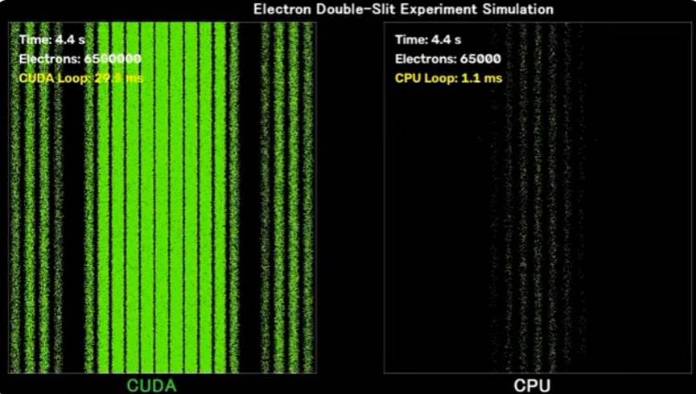

# 電子の二重スリット実験シミュレーション

量子力学における最も有名な実験の一つである「電子の二重スリット実験」を視覚的に再現するシミュレーションプログラムです。電子が波と粒子の二面性を持つ様子や、時間の経過とともにスクリーン上に干渉縞が形成されるプロセスを観察できます。

## 🎬 デモ（Demo / Performance Comparison）

### 📊 CUDA (GPU) と CPU の性能比較
同じ時間（4.4秒）経過時点での、CUDAによる並列計算と従来のCPU計算のシミュレーション比較です。GPUを用いることで、圧倒的な数の電子をリアルタイムに計算・描画し、干渉縞が瞬時に形成される様子を確認できます。

<!-- 
  リポジトリのルート（第一階層）に「images」フォルダを作成し、
  添付した画像を「comparison.png」という名前で保存してください。
-->


### 🎥 ポートフォリオ動画
実際の動作の様子や、より詳細なデモは以下のYouTube動画からご覧いただけます（画像をクリックすると動画が再生されます）。

[](https://youtube.com)

---

## 📌 特徴

* **圧倒的な高速化（CUDA対応）**: 大量の電子の挙動をGPUで超並列処理。CPU単体に比べて桁違いの電子数をリアルタイム描画可能。
* **リアルタイムな干渉縞の形成**: 電子が1個ずつスクリーンに衝突し、確率波の干渉によって美しい縞模様が徐々に浮かび上がるプロセスを視覚化。
* **パラメータ調整**: スリットの幅、スリット間の距離、電子の波長（エネルギー）などを自由に変更可能（※実装内容に応じて調整してください）。

## 🚀 動作環境（System Requirements）

* **OS**: Windows 11
* **GPU**: CUDA 13.3 以上に対応する NVIDIA 製 GPU（PCIe スロットに装着されていること）

## 🛠️ 前提条件（Prerequisites）

このプロジェクトをビルドするには、以下の開発環境とライブラリが必要です。

* **IDE**: Visual Studio 2026 (Community)
* **コンパイラ**: C++23 が利用できるビルド設定
* **グラフィックライブラリ**: OpenCV 5
* **ツールキット**: CUDA Toolkit 13.3+

## 💻 ビルドと実行方法

### 1. リポジトリのクローン
コマンドプロンプトや PowerShell を開き、以下のコマンドを実行してリポジトリをクローンします。

```bash
git clone https://github.com
cd DoubleSlit010
```

### 2. OpenCV 5 および CUDA の設定
1. Windows 11 環境に **OpenCV 5** および **CUDA 13.3** がインストールされていることを確認します。
2. 必要に応じて、環境変数（`PATH`）に OpenCV と CUDA のバイナリパスを通してください。

### 3. ビルド手順
1. `Visual Studio 2026` を起動し、クローンしたフォルダ内のソリューションファイル（`.sln`）を開きます。
2. 構成マネージャーで **Release** および **x64** を選択します。
3. プロジェクトのプロパティを開き、以下の設定を確認・適用します。
   * **C++ 言語標準**: `ISO C++23 標準 (/std:c++23)`
   * **インクルード/ライブラリ ディレクトリ**: OpenCV 5 および CUDA のパスを追加
4. ソリューションのビルド（`Ctrl + Shift + B`）を実行します。

### 4. 実行方法
ビルド完了後、生成された実行ファイルを実行します。OpenCVのウィンドウが立ち上がり、シミュレーションが開始されます。

```bash
.\x64\Release\DoubleSlit010.exe
```